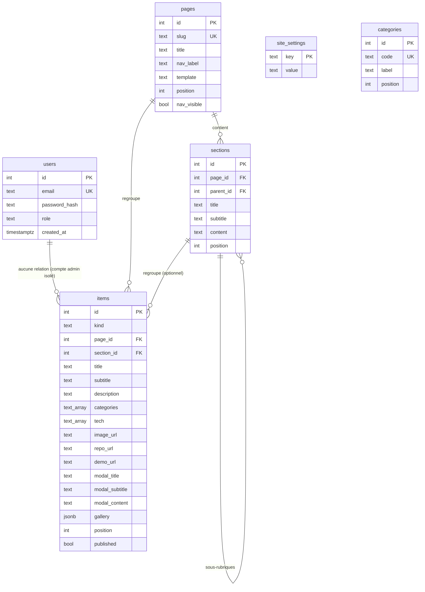

# Schéma de la base de données — Portfolio Laura Andriamifidy

> Version lisible du fichier [`schema.sql`](./schema.sql).
> Cible : **PostgreSQL** (hébergé sur **Supabase**).

## Vue d'ensemble

## Détail des tables

### `users`
Le **compte administrateur unique**. Il n'existe **aucune inscription publique** :
le compte est créé par le script `backend/scripts/create-admin.js` (mot de passe hashé en bcrypt).

| Colonne | Type | Description |
|---|---|---|
| `id` | serial PK | Identifiant |
| `email` | text UK | Adresse de connexion |
| `password_hash` | text | Hash bcrypt (jamais renvoyé par l'API) |
| `role` | text | `admin` par défaut |
| `created_at` | timestamptz | Date de création |

### `site_settings`
Paramètres éditoriaux du site, sous forme **clé / valeur** (éditables depuis `/studio`).

| Clé | Rôle |
|---|---|
| `brand_line1` | 1ʳᵉ ligne du nom dans la sidebar (ex. `Laura`) |
| `brand_line2` | 2ᵉ ligne du nom (ex. `Andriamifidy`) |
| `status` | Statut affiché sous le nom (ex. `Étudiante ingénieure`) |
| `footer_text` | Texte du pied de page — `{year}` est remplacé par l'année courante |
| `banner_image` | Image de la bannière d'accueil |
| `title_suffix` | Suffixe du `<title>` des onglets |

### `pages` — *rubriques du menu*
Chaque ligne = une entrée du menu latéral (une « rubrique »).

| Colonne | Type | Description |
|---|---|---|
| `id` | serial PK | |
| `slug` | text UK | URL (`/projets`, `/a-cote`…) |
| `title` | text | Titre affiché sur la page |
| `nav_label` | text | Libellé dans le menu |
| `template` | text | `home`, `projects`, `text` ou `items` |
| `position` | int | Ordre dans le menu |
| `nav_visible` | bool | Afficher ou non dans le menu |

**Templates disponibles :**
- `home` : bannière plein écran + sections de présentation (grand titre `h1`).
- `projects` : titre + filtre par catégorie + liste des `items` de type *project*.
- `text` : titre + sections `h2`/`h3` (texte libre).
- `items` : titre + liste des `items` de type *activity* (cartes avec fenêtre « En savoir plus »).

### `sections` — *rubriques & sous-rubriques*
Blocs de contenu textuel à l'intérieur d'une page.

| Colonne | Type | Description |
|---|---|---|
| `page_id` | FK → `pages` | Page de rattachement (suppression en cascade) |
| `parent_id` | FK → `sections` | `NULL` = rubrique ; renseigné = **sous-rubrique** |
| `title` | text | Titre (rendu en `h1` sur la page d'accueil, `h2` ailleurs) |
| `subtitle` | text | Sous-titre (rendu en `h2`) |
| `content` | text | Contenu **HTML** (paragraphes, listes, gras…) |
| `position` | int | Ordre d'affichage |

### `categories`
Catégories utilisées par le filtre de la page *Projets*.
`code` est la valeur technique (`dev`, `cybersec`, `ml`, `cloud`), `label` le texte affiché.

### `items` — *projets & activités*
Table principale du contenu. `kind` distingue :
- `project` → carte de la page *Projets* ;
- `activity` → carte de la page *À côté*.

| Colonne | Type | Description |
|---|---|---|
| `kind` | text | `project` ou `activity` |
| `page_id` | FK → `pages` | Page d'affichage |
| `section_id` | FK → `sections` | Regroupement optionnel dans une sous-rubrique |
| `title` | text | Titre de la carte |
| `subtitle` | text | Sous-titre (ex. `Piano – Chant – MAO`) |
| `description` | text | Description courte (HTML) |
| `categories` | text[] | Codes de catégories (projets) |
| `tech` | text[] | Badges de technologies |
| `image_url` | text | Illustration (chemin `/images/...` ou URL) |
| `repo_url` / `demo_url` | text | Liens GitHub / YouTube |
| `modal_title` / `modal_subtitle` | text | En-tête de la fenêtre « En savoir plus » |
| `modal_content` | text | Contenu HTML de la fenêtre |
| `gallery` | jsonb | `[{"url":"...","alt":"..."}]` |
| `position` | int | Ordre d'affichage |
| `published` | bool | Visible ou brouillon |

> Le contenu riche (`content`, `description`, `modal_content`) est stocké en **HTML**
> pour conserver exactement la mise en forme actuelle (`<b>`, ` `, `<ul>`, `<h3>`…).
